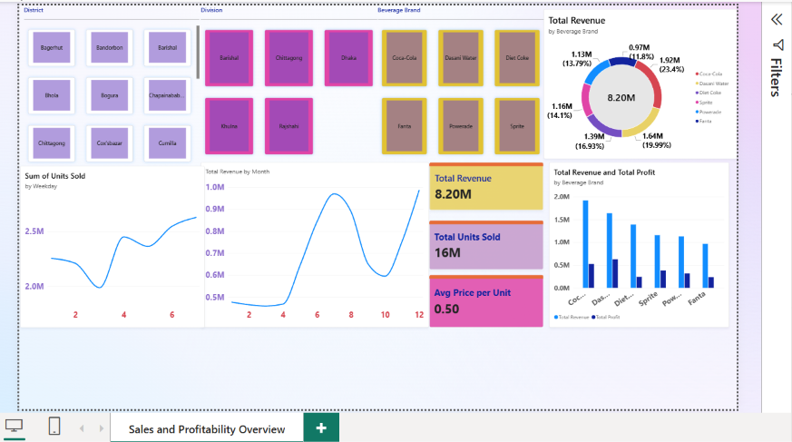

# Beverage Sales & Profitability Dashboard

Power BI dashboard analyzing beverage sales and profitability across brands, districts, and time.

**Tools:** Power BI, DAX, Power Query

## Overview

- **3,739 records** across 6 beverage brands (Coca-Cola, Dasani Water, Diet Coke, Sprite, Powerade, Fanta)
- Total revenue of **8.20M** and **16M units** sold, at an average price of **0.50** per unit
- Overall profit margin of **28.4%**

## Dashboard Features

- **Slicers:** District, Division, and Beverage Brand for interactive filtering
- **KPI cards:** Total Revenue, Total Units Sold, Average Price per Unit
- **Revenue share by brand:** donut chart
- **Monthly revenue trend:** line chart
- **Units sold by weekday:** line chart
- **Revenue vs. profit by brand:** clustered column chart

## Files

- `Beverage_Sales_Dashboard.pbix.pbix`: the Power BI file (open with Power BI Desktop)
- `dashboard-overview.png.png`: dashboard screenshot

## Data

Practice dataset used in a Power BI training exercise.

## Author

Abdullah Al Rafi Shakib, BSc in Statistics, Jagannath University, Dhaka
Email: alrafisakib07@gmail.com
